<div align="center">


# TripWise

**Plan smarter trips across India, with TripMate AI.**

An Android travel planner built with Kotlin and Jetpack Compose, backed by a Node.js/Express API
that keeps the Gemini key on the server.

[](https://github.com/ruksar-khatun/TripWise-v2/actions/workflows/ci.yml)
[](https://github.com/ruksar-khatun/TripWise-v2/actions/workflows/demo.yml)


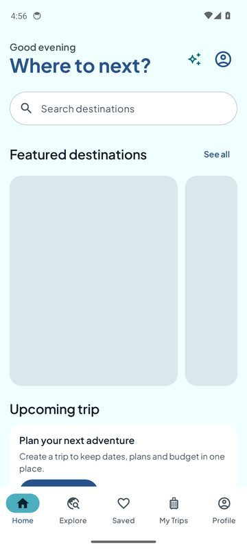&nbsp;
&nbsp;
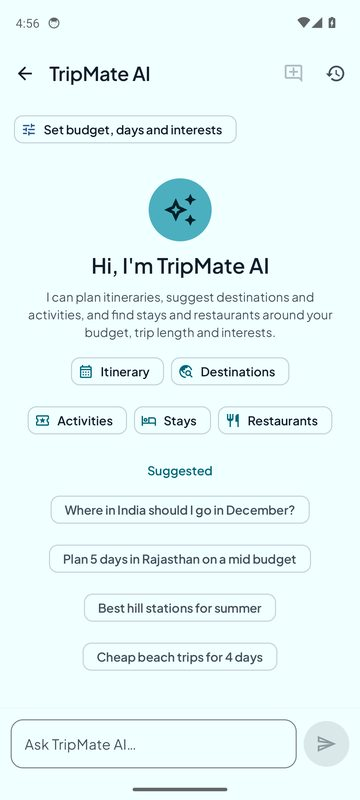&nbsp;
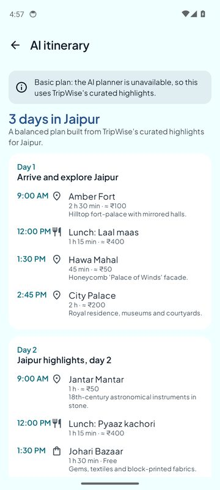

</div>

---

## Overview

TripWise helps travellers discover Indian destinations, plan day-by-day itineraries, track trip budgets and
get personalised advice from **TripMate AI**, an assistant powered by Google Gemini.

The project has two parts:

| Part | What it is |
|---|---|
| **Android app** (`android/`) | Kotlin, Jetpack Compose and Material 3 app with a modular, offline-first architecture (Hilt, Room, DataStore, Retrofit, Navigation Compose). Trips, itineraries, expenses, saved places and chat history live on the device. |
| **Backend** (`backend/`) | Node.js 22 + Express 5 + TypeScript API. It handles accounts (Argon2id + JWT), the curated destination catalog, currency rates and every AI call. **The Gemini API key exists only here.** It uses PostgreSQL in production and embedded PGlite in development. |

### Highlights

- **16 curated Indian destinations** (Agra, Jaipur, Kerala, Goa, Varanasi, Udaipur, Ladakh, Rishikesh, Mumbai, Delhi,
  Hampi, Darjeeling, Munnar, Andaman, Jaisalmer, Amritsar). Each has highlights, local food, attractions, typical
  costs in ₹ and credited photos.
- **TripMate AI**: streaming chat, personalised by budget, trip length, group size and interests. It gives structured
  stay and restaurant recommendations, keeps chat history, and opens from Home, Destination details, My Trips and the planner.
- **AI itinerary planner**: a validated day-by-day plan you can save as a trip. If AI is unavailable, it falls back to a curated plan.
- **Trips and budgets**: create trips, edit itinerary activities, estimate costs by category, set a planned budget and log expenses.
- **Google Maps without an API key**: every map action opens the Google Maps app (or google.com/maps) through free Maps URLs.
- **Production-minded**: offline-first data, typed errors end to end, encrypted tokens, rate limits, an accessible UI
  with dark mode, CI on every push, and an automated emulator walkthrough that publishes screenshots.

---

## Table of contents

1. [Screenshots](#screenshots)
2. [Features](#features)
3. [TripMate AI](#tripmate-ai)
4. [Architecture](#architecture)
5. [Tech stack](#tech-stack)
6. [Project structure](#project-structure)
7. [Code walkthrough (snippets)](#code-walkthrough)
8. [Backend API](#backend-api)
9. [Data and persistence](#data-and-persistence)
10. [Security and authentication](#security-and-authentication)
11. [Configuration](#configuration)
12. [Getting started](#getting-started)
13. [Testing and CI](#testing-and-ci)
14. [Design system](#design-system)
15. [Conventions](#conventions)
16. [Known limitations](#known-limitations)
17. [Credits](#credits)

---

## Screenshots

All screenshots come from the automated emulator tour (`AppTourTest`) running on an Android 14 emulator in CI.

### Onboarding and home

| Sign in | Create account | Home | Home (scrolled) |
|:-:|:-:|:-:|:-:|
| 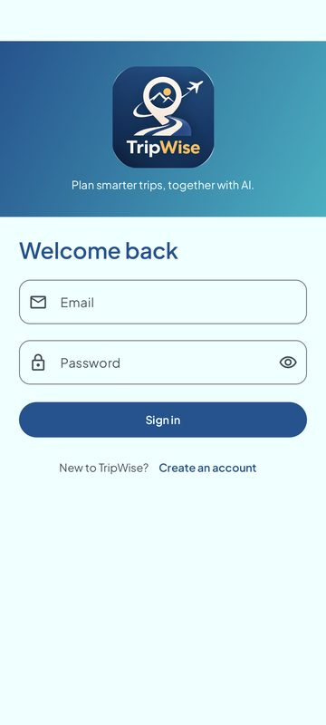 | 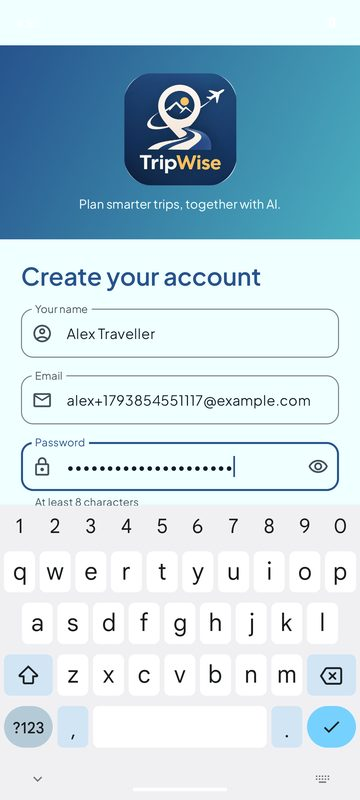 |  | 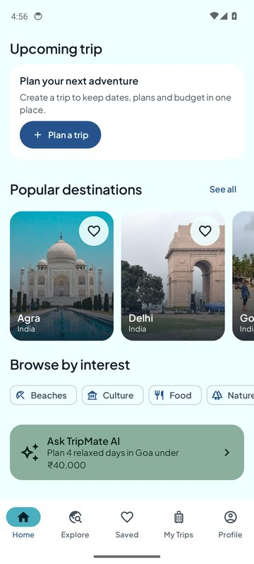 |

### Explore and destinations

| Explore | Destination | Details (scrolled) | Ask TripMate AI section |
|:-:|:-:|:-:|:-:|
| 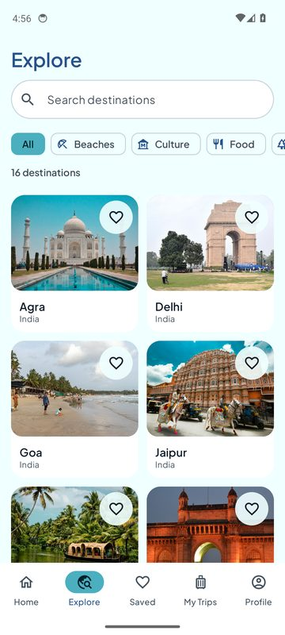 |  | 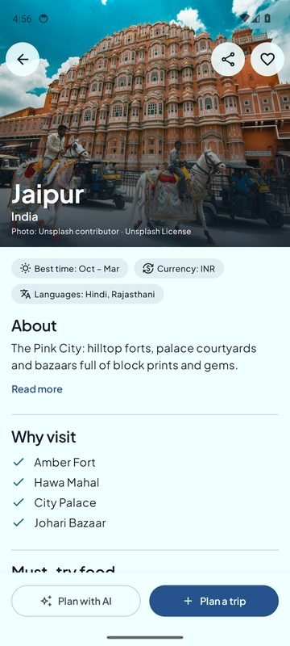 |  |

| Things to do | On Google Maps | Google Maps card |
|:-:|:-:|:-:|
| 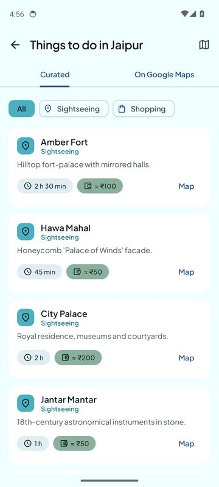 | 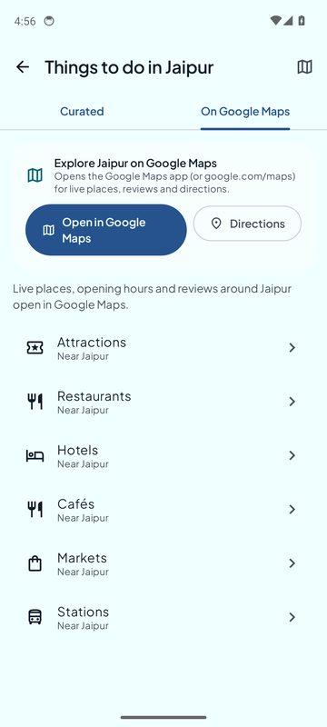 | 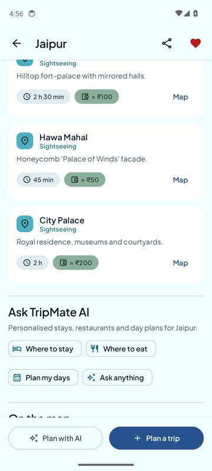 |

### TripMate AI

| Welcome and quick actions | Trip preferences | Chat history | Chat about a trip |
|:-:|:-:|:-:|:-:|
|  | 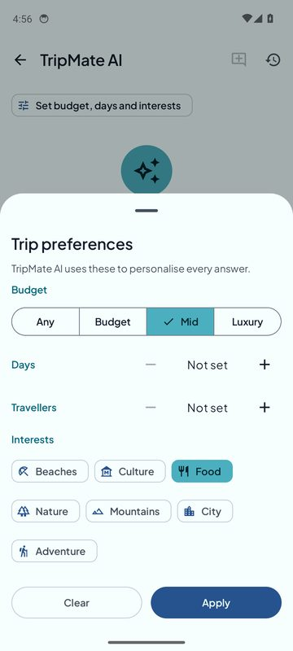 | 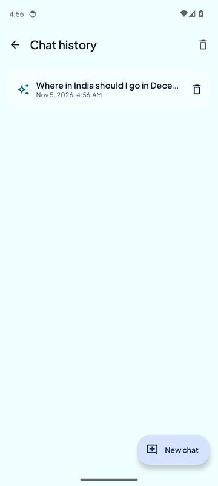 | 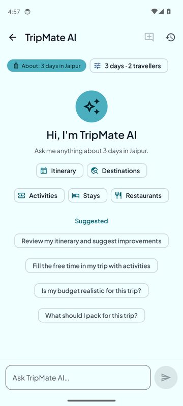 |

### AI itinerary planner

| Preferences | Generated plan | Save or refine |
|:-:|:-:|:-:|
| 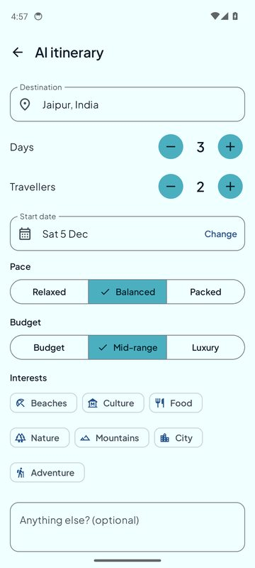 |  | 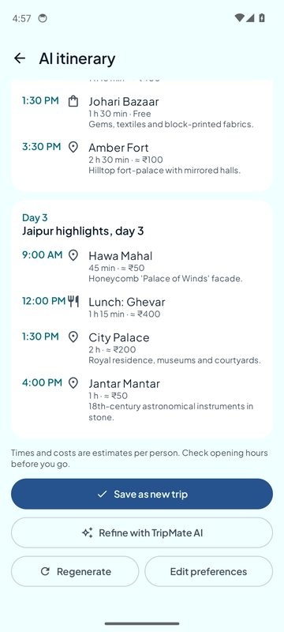 |

> The plan shown here is the **curated fallback**, because the CI run had no Gemini key ("Basic plan: the AI planner is
> unavailable…"). With `GEMINI_API_KEY` set, the same screen shows the Gemini-generated plan.

### My Trips and budget

| Trip overview | Itinerary | Cost estimate | Budget and expenses |
|:-:|:-:|:-:|:-:|
| 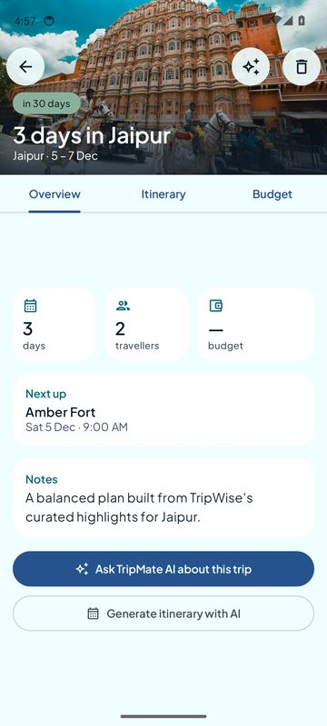 | 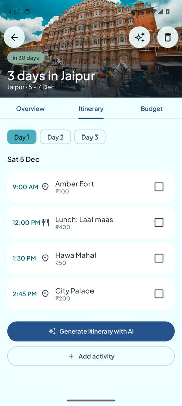 | 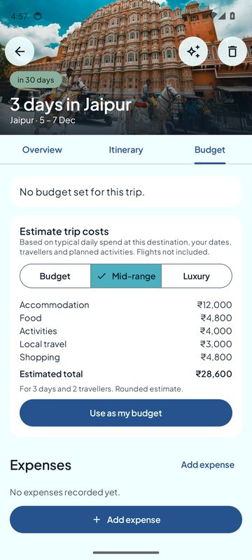 | 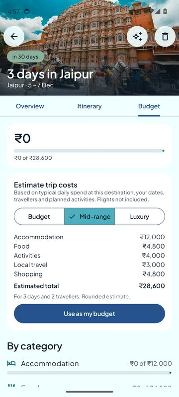 |

| Saved | My Trips | Profile |
|:-:|:-:|:-:|
| 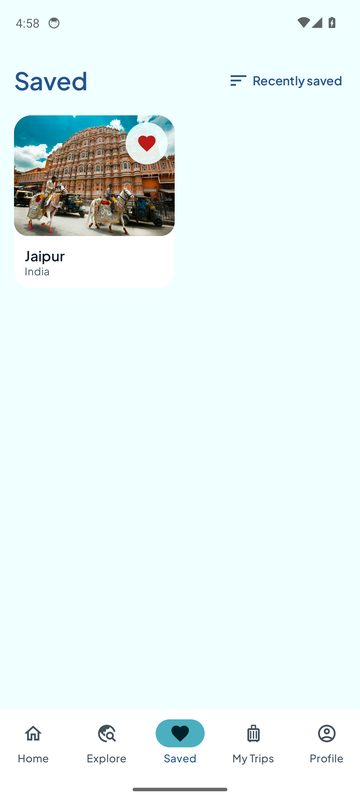 | 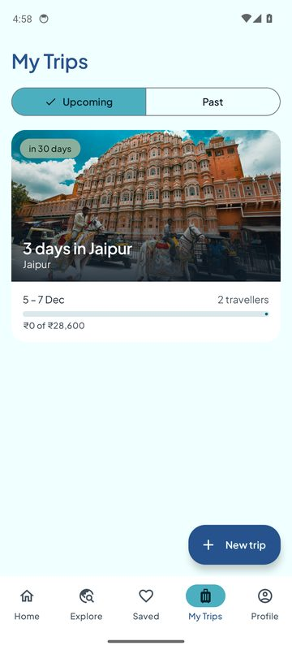 | 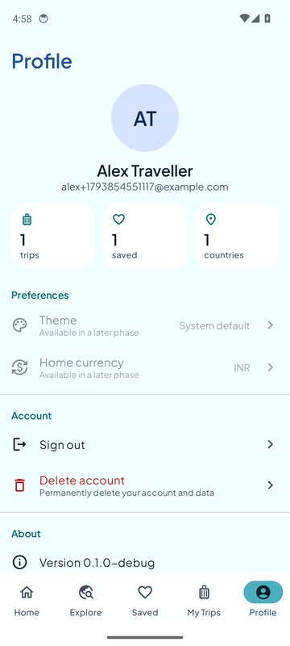 |

---

## Features

| Area | What it does | Needs |
|---|---|---|
| **Account** | Email/password sign-up and sign-in, session restore, sign-out, account deletion (asks for the password again); **guest mode** with no account or server (trips stay on the phone and carry over when you create an account) | Backend (guest: –) |
| **Home** | Greeting, search, featured and popular carousels, upcoming trip, browse by interest, Ask TripMate AI card | Backend |
| **Explore** | 16 Indian destinations; search by name or state, interest filters, adaptive grid, tablet list–detail layout | Backend |
| **Destination details** | Photo pager with credits, facts (best time, currency, languages), about, why visit, must-try food, things to do, Ask TripMate AI, Google Maps card, save and share | Backend |
| **Things to do** | Curated attractions filtered by category; an "On Google Maps" tab with attractions, restaurants, hotels, cafés, markets and stations nearby | – |
| **Maps** | No in-app map and **no Maps API key**. "Open in Google Maps", "Directions" and every "Map" button use [Maps URLs](https://developers.google.com/maps/documentation/urls/get-started), searching by place name and city | – |
| **TripMate AI** | Streaming travel chat, quick actions, contextual suggested prompts, budget/days/interest preferences, stay and restaurant cards, saved history | `GEMINI_API_KEY` |
| **AI itinerary** | Destination, days, travellers, pace, budget and interests produce a day-by-day plan you can save to a new or existing trip | `GEMINI_API_KEY` (falls back to a curated plan) |
| **My Trips** | Create, view and delete trips; Overview, Itinerary and Budget tabs; add, edit, delete and complete activities | – |
| **Budget and expenses** | Cost estimate per category from destination data (budget, mid-range or luxury), "use as my budget", expense log, spent vs planned | Backend (currency rates) |
| **Saved** | Save and remove with undo, sorting, consistent heart state everywhere | – |
| **Profile** | Stats (trips, saved, countries), preferences, sign-out, delete account, app version | – |

Without keys the app still runs. AI features show a clear "not set up" state, and the planner uses its curated fallback.

---

## TripMate AI

TripMate AI is the in-app travel assistant (`feature/assistant`). Its persona and rules live on the backend
(`backend/src/ai/chat.ts`). It focuses on travel within India and quotes prices in ₹.

**What it can do**

| Capability | How |
|---|---|
| Personalised itineraries | "Itinerary" quick action or a suggested prompt; answers with one section per day. "Open itinerary planner" turns it into a saveable plan |
| Discover destinations | "Destinations" quick action uses your budget, trip length and interests |
| Activities | "Activities" quick action for the current destination |
| **Stays and restaurants** | "Stays" and "Restaurants" call a structured endpoint (`POST /ai/recommendations`) and render **cards** with area, price range and a reason, each with *Open in Google Maps* |
| Travel Q&A | Free-form chat about budgets, transport, food, culture, packing and safety |

**Personalisation.** The *Trip preferences* sheet sets budget (Any, Budget, Mid or Luxury), days, travellers and interests.
They are sent with every request and stored with the conversation. When you open TripMate from a trip, days and
travellers are pre-filled, and the trip's dates, budget and planned activities are sent as context.

**Where it opens**

| Entry point | Context sent |
|---|---|
| Home → *Ask TripMate AI* | none (general chat) |
| Destination details → *Where to stay / Where to eat / Plan my days / Ask anything* | destination (stay and eat open straight into cards) |
| My Trips → trip → *Ask TripMate AI about this trip* | trip, budget, itinerary items, default preferences |
| AI planner → *Refine with TripMate AI* | destination or trip, plus a compact copy of the draft plan |

**Chat history** is saved on the device (Room tables `chat_conversations` and `chat_messages`), listed on the *Chat history*
screen (resume, delete one, delete all) and wiped on sign-out. A conversation is only created once it has a first message.

**Reliability.** Replies stream over Server-Sent Events with Stop and Retry. Errors are typed: not configured, quota
reached, unavailable, invalid output. Structured outputs are validated with zod and retried once. The backend falls back
to the next Gemini model if one is retired, overloaded or rate-limited. A per-user daily quota limits cost.

---

## Architecture

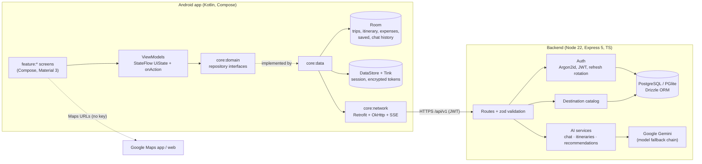

### Android module graph

Dependencies point one way. Features never depend on other features; `:app` wires cross-feature navigation.

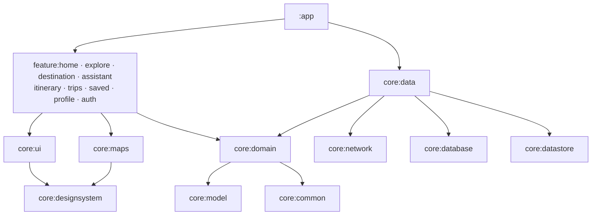

### Patterns

- **Unidirectional data flow (MVI-style):** each screen has a stateful `XxxScreen(viewModel)` that collects one
  `StateFlow<XxxUiState>` and passes it to a stateless `XxxScreen(state, onAction)`, which previews and tests target.
- **Offline-first:** Room is the source of truth for user data, and the UI observes `Flow`s. Network results are mapped into the database or into models.
- **Typed errors:** repositories never throw. They return `Outcome<T>` with a classified `AppError`, which `core:ui` maps to user-facing text.
- **Type-safe navigation:** `@Serializable` routes and `NavController.navigateToXxx()` helpers per feature.
- **Adaptive UI:** `NavigationSuiteScaffold` gives a bottom bar on phones and a rail on tablets, plus list–detail layouts on wide screens.

---

## Tech stack

### Android

| Concern | Library (version) |
|---|---|
| Language and build | Kotlin 2.4.21, AGP 9.0.0, Gradle convention plugins, version catalog |
| UI | Jetpack Compose (BOM 2025.10.01), Material 3, Material 3 Adaptive / NavigationSuite, Coil 3.4.0 |
| Navigation | Navigation Compose 2.9.5 (type-safe routes) |
| DI | Hilt 2.60.1 with KSP 2.3.13 |
| Async | Kotlin Coroutines 1.11.0 and Flow |
| Persistence | Room 2.8.3 (exported schemas and migrations), DataStore 1.1.7 |
| Security | Tink 1.24.0 (AES-256-GCM, key held in Android Keystore) |
| Networking | Retrofit 3.0.0, OkHttp 5.4.0, kotlinx.serialization 1.12.0, Server-Sent Events reader |
| Testing | JUnit 4, Robolectric 4.17, Turbine 1.2.1, Compose UI tests, AndroidX Test |
| SDK levels | minSdk 26 · targetSdk 36 · compileSdk 36 |

### Backend

| Concern | Library |
|---|---|
| Runtime | Node.js ≥ 22, TypeScript |
| HTTP | Express 5, zod 4 (validation), pino 10 (logging), rate limiting |
| Auth | `@node-rs/argon2` (Argon2id), `jose` (JWT HS256) |
| Database | Drizzle ORM, PostgreSQL (`pg`) in production, PGlite (embedded Postgres) in development and tests |
| AI | `@google/genai` (Gemini; streaming chat and JSON-schema output) |
| Testing | Vitest + Supertest (embedded Postgres, fake AI client) |
| Deploy | Dockerfile for Cloud Run; migrations run on start |

---

## Project structure

```text
TripWise-v2/
├── .github/workflows/
│   ├── ci.yml                    # Android build, unit tests, lint; backend typecheck and tests; catalog image check
│   ├── demo.yml                  # Boots backend + Android emulator, runs AppTourTest, publishes screenshots
│   └── image-candidates.yml      # Finds licensed Wikimedia Commons photo candidates for the catalog
├── docs/
│   ├── logo.png
│   └── screenshots/              # Images used in this README (from the emulator tour)
├── scripts/                      # Catalog image checks and candidate search
├── backend/
│   ├── catalog/destinations.json # Curated catalog: 16 Indian destinations, attractions, costs (INR), photo credits
│   ├── drizzle/                  # SQL migrations (generated by drizzle-kit)
│   ├── Dockerfile
│   ├── src/
│   │   ├── server.ts             # Entry point
│   │   ├── app.ts                # Express app, routers, dependency wiring
│   │   ├── ai/
│   │   │   ├── gemini.ts         # GeminiClient (stream + JSON), model fallback, DailyQuota
│   │   │   ├── chat.ts           # TripMate AI system prompt (persona, context, preferences)
│   │   │   ├── itinerary.ts      # AI itinerary: schema, validation, normalisation, curated fallback
│   │   │   └── recommendations.ts# Stays and restaurants as validated structured cards
│   │   ├── auth/                 # passwords (Argon2id), tokens (JWT + refresh rotation), service, middleware
│   │   ├── catalog/              # Catalog types (zod) and service (seeded into Postgres)
│   │   ├── config/               # env (zod-validated) and logger
│   │   ├── currency/             # Exchange-rate service
│   │   ├── db/                   # Drizzle schema and client (pg or PGlite)
│   │   ├── http/                 # HttpError + shared error codes, request validation
│   │   ├── middleware/           # Error envelope middleware
│   │   ├── places/               # Optional Places proxy (not used by the app)
│   │   └── routes/               # ai, auth, me, destinations, currency, places, health
│   └── test/                     # Vitest suites: ai, app, auth, catalog, currency, places
└── android/                      # Open this folder in Android Studio
    ├── build-logic/convention/   # Convention plugins: android.{application,library,compose,feature,room}, hilt, jvm.library
    ├── gradle/libs.versions.toml # Every dependency version
    ├── app/                      # Application, MainActivity, NavHost, top-level destinations, AppTourTest
    ├── core/
    │   ├── common/               # (JVM) Outcome, AppError, dispatchers, Clock
    │   ├── model/                # (JVM) Domain models: Destination, Trip, ItineraryItem, Chat, TripPreferences…
    │   ├── domain/               # (JVM) Repository interfaces and use cases (e.g. EstimateTripCostUseCase)
    │   ├── network/              # Retrofit APIs, DTOs, ApiErrorMapper, SSE chat data source, auth interceptor
    │   ├── database/             # Room DB (v2), entities, DAOs, migrations, exported schemas
    │   ├── datastore/            # Preferences DataStore, Tink-encrypted token storage
    │   ├── data/                 # Repository implementations, mappers, connectivity monitor
    │   ├── designsystem/         # TripWiseTheme (colors, type, shapes, spacing), Tw* components, TwIcons, logo
    │   ├── ui/                   # Loading/empty/error states, AppError → message, formatters, shared cards
    │   ├── maps/                 # Google Maps URL hand-off (GoogleMapsLinks, GoogleMapsCard)
    │   └── testing/              # Fakes, TestData, MainDispatcherRule
    └── feature/
        ├── auth/                 # Sign in, sign up, session gate
        ├── home/                 # Home dashboard
        ├── explore/              # Search, filters, adaptive grid / list–detail
        ├── destination/          # Destination details, Things to do, Google Maps shortcuts
        ├── assistant/            # TripMate AI chat, preferences sheet, chat history
        ├── itinerary/            # AI itinerary planner
        ├── trips/                # My Trips list, create, detail (overview, itinerary, budget)
        ├── saved/                # Saved destinations
        └── profile/              # Profile, settings, account
```

---

## Code walkthrough

Short excerpts from the codebase, showing how the main pieces fit together.

### 1. Typed results and errors (`core/common`)

Repositories never throw. Every failure is classified once and turned into text in one place.

```kotlin
sealed interface Outcome<out T> {
    data class Success<out T>(val value: T) : Outcome<T>
    data class Failure(val error: AppError) : Outcome<Nothing>
}

sealed interface AppError {
    data object Network : AppError
    data object Timeout : AppError
    data object Unauthorized : AppError
    data class Ai(val reason: AiFailure) : AppError
    data object NotConfigured : AppError        // e.g. the server has no Gemini key
    data class Server(val httpCode: Int) : AppError
    // … Validation, RateLimited, Conflict, NotFound, Unknown
}

val AppError.isRetryable: Boolean
    get() = when (this) {
        AppError.Network, AppError.Timeout, AppError.RateLimited, is AppError.Server -> true
        is AppError.Ai -> reason != AiFailure.QUOTA_EXCEEDED
        else -> false
    }
```

### 2. Screen → ViewModel → UiState (`feature/assistant`)

One immutable state, one entry point for user intents.

```kotlin
data class AssistantUiState(
    val ready: Boolean = false,
    val destinationName: String? = null,
    val preferences: TripPreferences = TripPreferences(),
    val messages: List<ChatMessage> = emptyList(),
    val input: String = "",
    val streamingId: String? = null,        // assistant bubble currently streaming
    val recommending: PlaceKind? = null,    // loading stay/restaurant cards
    val error: AppError? = null,
) {
    val busy: Boolean get() = streamingId != null || recommending != null
    val canSend: Boolean get() = ready && input.isNotBlank() && !busy
}

sealed interface AssistantAction {
    data class InputChanged(val text: String) : AssistantAction
    data object Send : AssistantAction
    data class Recommend(val kind: PlaceKind) : AssistantAction
    data class UpdatePreferences(val preferences: TripPreferences) : AssistantAction
    data object Retry : AssistantAction
    data object Stop : AssistantAction
    data object NewChat : AssistantAction
}

@Composable
internal fun AssistantScreen(navigation: AssistantNavigation, viewModel: AssistantViewModel = hiltViewModel()) {
    val state by viewModel.uiState.collectAsStateWithLifecycle()
    AssistantScreen(state, viewModel::onAction, navigation)   // stateless, previewable
}
```

### 3. Type-safe navigation with launch arguments

```kotlin
@Serializable
data class AssistantRoute(
    val tripId: String? = null,
    val destinationId: String? = null,
    val conversationId: String? = null,   // resume a saved chat
    val prompt: String? = null,           // sent as the first message
    val starter: String? = null,          // "STAY" / "FOOD": open straight into cards
)

fun NavController.navigateToAssistant(tripId: String? = null, destinationId: String? = null,
                                      prompt: String? = null, starter: PlaceKind? = null) =
    navigate(AssistantRoute(tripId, destinationId, prompt = prompt?.take(2_000), starter = starter?.name))

// :app wires features together, e.g. Destination details → TripMate AI:
onAskTripMate = { id, prompt, starter -> nav.navigateToAssistant(destinationId = id, prompt = prompt, starter = starter) }
```

### 4. Building the AI request with context (`core/data`)

```kotlin
fun buildChatRequest(history: List<ChatMessage>, context: AssistantContext): ChatRequestDto {
    val turns = history.map { it.copy(text = it.asPromptText()) }        // place cards become text
        .filter { it.text.isNotBlank() }.takeLast(MAX_TURNS)
        .dropWhile { it.role != ChatRole.USER }                          // API must start with a user turn
        .map { ChatMessageDto(if (it.role == ChatRole.USER) "user" else "assistant", it.text.take(4_000)) }
    val trip = context.trip?.let { t ->
        ChatTripDto(t.title, t.destinationName, t.startDate.toString(), t.endDate.toString(), t.travellers,
            budgetInr = t.budget?.takeIf { it.currency.code == "INR" }?.let { it.amountMinor / 100 },
            itinerary = context.itinerary.take(40).map { "${it.date} ${it.startTime ?: ""} ${it.title}".trim() })
    }
    val p = context.preferences
    val preferences = if (p.isEmpty) null else ChatPreferencesDto(p.budgetLevel?.name, p.days, p.travellers, p.interests.map { it.name })
    return ChatRequestDto(turns, ChatContextDto(context.destinationId, trip, preferences))
}
```

### 5. Chat history in Room (`core/database`)

```kotlin
@Dao
abstract class ChatDao {
    @Query("""
        SELECT c.*, (SELECT m.text FROM chat_messages m WHERE m.conversation_id = c.id AND m.text != ''
                     ORDER BY m.created_at DESC LIMIT 1) AS preview
        FROM chat_conversations c ORDER BY c.updated_at DESC
    """)
    abstract fun observeConversations(): Flow<List<ChatConversationSummary>>

    /** Saves a message and bumps its conversation to the top of the history. */
    @Transaction
    open suspend fun saveMessage(message: ChatMessageEntity, now: Instant) {
        upsertMessage(message)
        touch(message.conversationId, now)
    }
    // …
}

internal val MIGRATION_1_2 = object : Migration(1, 2) {   // v2 adds TripMate AI chat history
    override fun migrate(db: SupportSQLiteDatabase) {
        db.execSQL("CREATE TABLE IF NOT EXISTS `chat_conversations` (…)")
        db.execSQL("CREATE TABLE IF NOT EXISTS `chat_messages` (… FOREIGN KEY(`conversation_id`) … ON DELETE CASCADE )")
    }
}
```

### 6. Google Maps without an API key (`core/maps`)

```kotlin
object GoogleMapsLinks {
    private const val BASE = "https://www.google.com/maps"
    fun searchUrl(query: String) = "$BASE/search/?api=1&query=${Uri.encode(query)}"
    fun directionsUrl(destination: String) = "$BASE/dir/?api=1&destination=${Uri.encode(destination)}"
    fun nearbyQuery(what: String, place: String) = "$what near $place"
}

/** Google Maps app if installed, otherwise any browser. */
fun openInGoogleMaps(context: Context, url: String): Boolean {
    val intent = Intent(Intent.ACTION_VIEW, Uri.parse(url)).addFlags(Intent.FLAG_ACTIVITY_NEW_TASK)
    return try { context.startActivity(intent.setPackage("com.google.android.apps.maps")); true }
    catch (_: ActivityNotFoundException) {
        try { context.startActivity(intent.setPackage(null)); true } catch (_: ActivityNotFoundException) { false }
    }
}

// Attraction "Map" button: search by name + city (curated coordinates are approximate)
AttractionCard(a, onShowOnMap = { openSearch(context, placeLabel(a.name, destination.name, destination.region)) })
```

### 7. Streaming chat over Server-Sent Events (`backend/src/routes/ai.ts`)

```ts
router.post('/chat', validate({ body: ChatBody }), async (req, res) => {
  if (!deps.ai.configured) throw HttpError.notConfigured('The AI assistant');
  if (!deps.quota.take(res.locals.userId)) throw quotaExceeded();
  const body = res.locals.valid.body as z.infer<typeof ChatBody>;
  const destination = body.context?.destinationId ? await deps.catalog.get(body.context.destinationId).catch(() => undefined) : undefined;
  const system = chatSystemPrompt({ destination, trip: body.context?.trip, preferences: body.context?.preferences });

  res.status(200).set({ 'Content-Type': 'text/event-stream', 'Cache-Control': 'no-cache' });
  const send = (event: string | null, data: object) =>
    res.write(`${event ? `event: ${event}\n` : ''}data: ${JSON.stringify(data)}\n\n`);
  try {
    for await (const delta of deps.ai.streamChat(system, turns, abort.signal)) send(null, { delta });
    send(null, { done: true });
  } catch {
    send('error', { code: ErrorCode.AI_UNAVAILABLE, message: 'The assistant is unavailable right now' });
  } finally {
    res.end();
  }
});
```

### 8. Gemini model fallback (`backend/src/ai/gemini.ts`)

```ts
/** Retired (404), rate-limited (429) or overloaded (5xx) models fall back to the next one. */
export function isFallbackWorthy(err: unknown): boolean {
  const status = (err as { status?: number })?.status;
  return status === 404 || status === 429 || status === 500 || status === 503 || status === 504;
}

async generateJson(system: string, prompt: string, jsonSchema: object): Promise<unknown> {
  let lastError: unknown;
  for (const model of this.models) {          // GEMINI_MODEL, then GEMINI_FALLBACK_MODELS
    try { return await this.generateJsonWith(model, system, prompt, jsonSchema); }
    catch (err) { if (!isFallbackWorthy(err)) throw err; lastError = err; }
  }
  throw lastError;
}
```

### 9. Validated structured AI output (`backend/src/ai/recommendations.ts`)

```ts
const Place = z.object({
  name: z.string().trim().min(1).max(80),
  area: z.string().trim().max(80).default(''),
  type: z.string().trim().max(40).default(''),
  priceRangeInr: z.string().trim().max(40).default(''),
  description: z.string().trim().max(240).default(''),
});
const Draft = z.object({ places: z.array(Place).min(1) });

for (let attempt = 1; attempt <= 2; attempt++) {            // retry invalid output once
  try {
    const draft = Draft.parse(await this.ai.generateJson(SYSTEM, prompt, JSON_SCHEMA));
    const seen = new Set<string>();
    const places = draft.places.filter((p) => !seen.has(p.name.toLowerCase()) && seen.add(p.name.toLowerCase())).slice(0, 5);
    return { kind: r.kind, destinationId: d.id, places };
  } catch (err) { this.log?.warn({ err, attempt }, 'AI recommendations invalid or failed'); }
}
throw new HttpError(502, ErrorCode.AI_UNAVAILABLE, 'TripMate AI could not find recommendations right now');
```

### 10. Build reliability: serialised KSP (`build-logic`)

```kotlin
/** KSP2 runs in parallel intermittently left dependency types unresolved, so Hilt skipped ViewModels. */
internal fun Project.serializeKspTasks() {
    val lock = gradle.sharedServices.registerIfAbsent("tripwiseKspLock", KspLock::class.java) { maxParallelUsages.set(1) }
    tasks.matching { it.name.startsWith("ksp") && it.name.endsWith("Kotlin") }.configureEach {
        usesService(lock)
        outputs.doNotCacheIf("KSP output must come from a fresh, serialised run") { true }
    }
}
```

---

## Backend API

Base path `/api/v1`. JSON in and out. Errors always use one envelope:
`{ "error": { "code", "message", "details?", "serverVersion?" } }`.

| Method | Path | Auth | Description |
|---|---|:-:|---|
| GET | `/health` | – | Liveness check |
| POST | `/auth/register` | – | Create an account → `{ user, tokens }` (rate-limited) |
| POST | `/auth/login` | – | Sign in → `{ user, tokens }` (rate-limited) |
| POST | `/auth/refresh` | – | Rotate refresh token → new token pair |
| POST | `/auth/logout` | – | Revoke the refresh token |
| GET / PATCH / DELETE | `/me` | ✔ | Read or update the profile; delete the account (password required) |
| GET | `/destinations?query=&interest=` | – | Search the curated catalog |
| GET | `/destinations/:id` | – | One destination with attractions, costs and images |
| GET | `/currency/rates` | – | Exchange rates for budget conversion |
| POST | `/ai/chat` | ✔ | TripMate AI chat, streamed as SSE (`data: {"delta"}` … `data: {"done":true}`, or `event: error`) |
| POST | `/ai/itineraries` | ✔ | Day-by-day plan (`source: "ai"` or `"template"`) |
| POST | `/ai/recommendations` | ✔ | Stays (`STAY`) or restaurants (`FOOD`) as structured cards |
| GET | `/places/nearby` | ✔ | Optional Google Places proxy (needs `PLACES_API_KEY`; not used by the app) |

**Example: recommendations**

```http
POST /api/v1/ai/recommendations
Authorization: Bearer <access token>
Content-Type: application/json

{ "destinationId": "jaipur", "kind": "FOOD", "budgetLevel": "MID", "travellers": 2, "interests": ["FOOD"] }
```

```json
{
  "kind": "FOOD",
  "destinationId": "jaipur",
  "places": [
    { "name": "…", "area": "Johari Bazaar", "type": "Sweets and thali", "priceRangeInr": "₹400-800 for two", "description": "…" }
  ]
}
```

**Error codes** (shared with Android's `ApiErrorCode`): `VALIDATION_FAILED`, `UNAUTHORIZED`, `INVALID_CREDENTIALS`,
`FORBIDDEN`, `NOT_FOUND`, `CONFLICT`, `RATE_LIMITED`, `NOT_CONFIGURED`, `UPSTREAM_FAILED`, `AI_UNAVAILABLE`,
`AI_QUOTA_EXCEEDED`, `AI_INVALID_OUTPUT`, `INTERNAL`.

---

## Data and persistence

### On the device (Room, schema version 2)

| Table | Holds |
|---|---|
| `trips` | Title, destination, dates, travellers, budget (minor units + currency), notes, sync state |
| `itinerary_items` | Per-trip activities: date, time, category, cost, done flag |
| `budget_allocations` | Planned amount per expense category per trip |
| `expenses` | Logged expenses |
| `saved_destinations` | Saved places with timestamp |
| `chat_conversations` | TripMate AI conversations: title, destination/trip, preferences, timestamps |
| `chat_messages` | Messages (role, text, structured places as JSON), cascade-deleted with their conversation |

Money is always stored as **minor units + ISO currency**, never as floating point. Schema changes need a version bump, a
migration and the exported schema JSON. `MIGRATION_1_2` is verified by a Robolectric test that upgrades a real v1 file.
Sign-out and account deletion clear every table.

### On the server (PostgreSQL via Drizzle)

| Table | Holds |
|---|---|
| `users` | Email, Argon2id hash, display name, home currency |
| `refresh_tokens` | SHA-256 hashes of refresh tokens, rotation family, expiry, revocation |
| `destinations` | The curated catalog, seeded from `backend/catalog/destinations.json` |

---

## Security and authentication

- **Passwords:** Argon2id with OWASP parameters. Login failures give one generic message, and unknown emails take as long to reject as wrong passwords.
- **Access token:** 15-minute HS256 JWT.
- **Refresh token:** opaque 256-bit value, stored only as a SHA-256 hash and rotated on every refresh.
  Re-using an already-rotated token revokes the whole sign-in family.
- **On Android:**
  - Tokens are encrypted with Tink AES-256-GCM using a key in Android Keystore, and excluded from backups.
  - After a 401, the app refreshes once (shared by concurrent requests) and retries. A rejected refresh signs the user out with an "expired" notice.
- **Rate limiting:** credential endpoints are limited per IP (20 requests per 15 minutes). AI endpoints have a per-user daily quota (`AI_DAILY_LIMIT`).
- **Secrets:** the Gemini key lives only on the backend; the app ships with **no API keys**. Release builds are HTTPS-only.
- **Prompt safety:** user content, trip notes and preferences are treated as data, never as instructions. Structured AI output is schema-validated before use.

---

## Configuration

### Backend (`backend/.env`, from `.env.example`)

| Variable | Default | Purpose |
|---|---|---|
| `PORT` | `3000` | HTTP port |
| `NODE_ENV` | `development` | `production` enables strict checks |
| `LOG_LEVEL` | `info` | pino log level |
| `CORS_ORIGINS` | *(empty)* | Comma-separated origins (the app doesn't need CORS) |
| `DATABASE_URL` | *(empty → PGlite)* | PostgreSQL URL; required in production |
| `JWT_SECRET` | – | ≥ 32 characters; required in production |
| `ACCESS_TOKEN_TTL_SECONDS` | `900` | Access token lifetime |
| `REFRESH_TOKEN_TTL_DAYS` | `30` | Refresh token lifetime |
| `GEMINI_API_KEY` | – | Google AI Studio key; enables TripMate AI and the AI planner |
| `GEMINI_MODEL` | `gemini-3.5-flash` | Primary model |
| `GEMINI_FALLBACK_MODELS` | `gemini-3.8-flash,gemini-3.1-flash-lite` | Tried in order on 404/429/5xx |
| `AI_DAILY_LIMIT` | `100` | AI requests per user per UTC day |
| `PLACES_API_KEY` | – | Optional; only for the unused `/places` proxy |

### Android (`android/local.properties`, from `local.properties.example`)

```properties
sdk.dir=/path/to/Android/sdk
# 10.0.2.2 is your computer as seen from the Android emulator
BACKEND_BASE_URL=http://10.0.2.2:3000/
# Release builds (HTTPS only)
BACKEND_BASE_URL_RELEASE=https://your-backend.example.com/
```

### GitHub Actions secrets

| Secret | Used by |
|---|---|
| `GEMINI_API_KEY` | `demo.yml`: lets the emulator tour show real AI answers |

---

## Getting started

### Prerequisites

- **Android:** Android Studio (recent stable, with AGP 9 support), JDK 21, Android SDK 36
- **Backend:** Node.js 22+ and npm. PostgreSQL is optional locally, since PGlite is embedded.

### 1. Run the backend

```bash
cd backend
cp .env.example .env          # add GEMINI_API_KEY to enable AI
npm install
npm run dev                   # http://localhost:3000/api/v1/health
```

Other commands:

```bash
npm test                      # Vitest suites (embedded Postgres, fake AI)
npm run typecheck
npm run build && npm start    # production build
npm run db:generate           # after editing src/db/schema.ts: writes a SQL migration to ./drizzle
```

### 2. Run the Android app

1. Copy `android/local.properties.example` to `android/local.properties` and set `sdk.dir`.
2. Open the **`android/`** folder in Android Studio and sync Gradle.
3. Run the `app` configuration on an emulator. Debug builds call `http://10.0.2.2:3000/`, which is your machine.
4. Create an account on the sign-up screen and start exploring.

From the command line:

```bash
cd android
./gradlew :app:assembleDebug                 # build the debug APK
./gradlew testDebugUnitTest                  # all unit tests (JVM + Robolectric)
./gradlew :app:connectedDebugAndroidTest     # instrumented tests, including the app tour
```

**Physical device:** see [Run it on your phone](#run-it-on-your-phone).

### Run it on your phone

**Option A, no computer needed (guest mode).** Install the APK from the `ci-apk` branch
(`TripWise.apk`, rebuilt on every push), then tap **Continue as guest**.
The APK bundles the destination catalog and builds itineraries, cost estimates and trips on the phone.
TripMate AI and accounts need the backend, so guests get a clear "sign in to use this" message there.
If Android asks, allow *Install unknown apps* for your browser or file manager.

**Option B, everything including TripMate AI.** Run the backend on your computer and connect the phone:
- *USB:* set `BACKEND_BASE_URL=http://localhost:3000/` in `android/local.properties`, run `adb reverse tcp:3000 tcp:3000`, then run `app` from Android Studio.
- *Same Wi-Fi:* set `BACKEND_BASE_URL=http://<your computer's LAN IP>:3000/`. Debug builds allow plain HTTP for this; release builds are HTTPS-only.

### 3. Deploy (Cloud Run)

Build `backend/Dockerfile`. Then set `DATABASE_URL` (Cloud SQL), `JWT_SECRET` (48+ random bytes) and `GEMINI_API_KEY`
from Secret Manager. Migrations run automatically on start. Point `BACKEND_BASE_URL_RELEASE` at the service URL.

---

## Testing and CI

| Suite | What it covers |
|---|---|
| **Backend (Vitest, 43 tests)** | Auth (register/login/refresh rotation/reuse detection/deletion), catalog search, currency, AI chat SSE (context, validation, quota, mid-stream errors), itineraries (validation, normalisation, retry, fallback), recommendations (validation, de-duplication, retry, errors), model fallback |
| **Android unit tests (25 files, ~97 tests)** | ViewModels (TripMate AI, planner, trips, budget, explore, home, destination…), repositories and mappers, Room DAOs and the v1→v2 migration (Robolectric), Google Maps URL building, SSE stream parsing |
| **Emulator tour (`AppTourTest`)** | A scripted end-to-end walkthrough on an Android 14 emulator against a real backend: sign-up, home, TripMate AI (preferences, chat, history), explore, destination, things to do, Google Maps hand-off, planner → save trip → itinerary → budget estimate, saved, my trips, profile |

**Workflows**

- `ci.yml` (every push to `main`, pull requests, manual): Android debug and release builds, unit tests and lint; backend typecheck and tests; a check that every catalog photo URL resolves, plus a labelled contact sheet published to the `ci-image-review` branch.
- `demo.yml` (every push to `main`, manual): starts the backend with embedded Postgres, boots the emulator, runs the tour and publishes the screenshots to the `ci-screenshots` branch. The README images come from there.

---

## Design system

`core/designsystem` holds `TripWiseTheme` (light and dark), spacing, shapes, typography (Plus Jakarta Sans) and `Tw*` components
(`TwButton`, `TwCard`, `TwFilterChip`, `TwInfoPill`, `TwSegmentedButtons`, `TwTopAppBar`, `TwListRow`, `TwShimmer`…).

| Token | Color | Use |
|---|---|---|
| Azure Mist | `#F0FFFF` | Light background |
| Dusk Blue | `#26538D` | Primary: buttons, headings, user chat bubbles |
| Sea Blue | `#4BAFC0` | Secondary: chips, accents, selection |
| Sea Salt | `#8BAF9D` | Tertiary: cost pills, success tone |

Accessibility: semantic headings, content descriptions on icon buttons, live regions for streaming and errors,
large touch targets, and dynamic type and dark mode support.

---

## Conventions

- **Screens:** `XxxScreen(viewModel)` (stateful) → `XxxScreen(state, onAction)` (stateless).
- **ViewModels:** expose one `StateFlow<XxxUiState>` and handle intents in `onAction(XxxAction)`.
- **Repositories:** return `Outcome<T>` or `Flow<T>` and never throw. Errors are `AppError`, mapped to text in `core:ui`.
- **Navigation:** each feature exposes a `@Serializable` route, `NavController.navigateToXxx()` and `NavGraphBuilder.xxxScreen()`.
- **Backend errors:** always the `{ error: { code, message } }` envelope, with codes shared with Android.
- **Money:** minor units + currency everywhere. Catalog costs are in INR.
- **Secrets:** never committed. Backend secrets come from `.env` or Secret Manager; the app has none.

---

## Known limitations

- **AI needs a key.** Without `GEMINI_API_KEY` on the server, TripMate AI shows "not set up" and the planner uses its curated fallback.
- **AI recommendations aren't verified.** Stay and restaurant names, prices and descriptions come from the model. The app
  says so and links each one to Google Maps to check before booking.
- **Chat history is device-local.** It isn't synced to the account and is cleared on sign-out.
- **No in-app map.** By design, maps open in Google Maps so no paid Maps/Places key is needed.
- **Catalog scope.** 16 curated Indian destinations. Ratings are intentionally not shown until there is a real review source.

---

## Credits

- Destination photos: [Wikimedia Commons](https://commons.wikimedia.org/) (author and licence shown in the app) and Unsplash.
- AI: Google Gemini via the `@google/genai` SDK.
- Maps: Google Maps [URLs](https://developers.google.com/maps/documentation/urls/get-started) (no API key).
- Font: Plus Jakarta Sans (SIL Open Font License).
